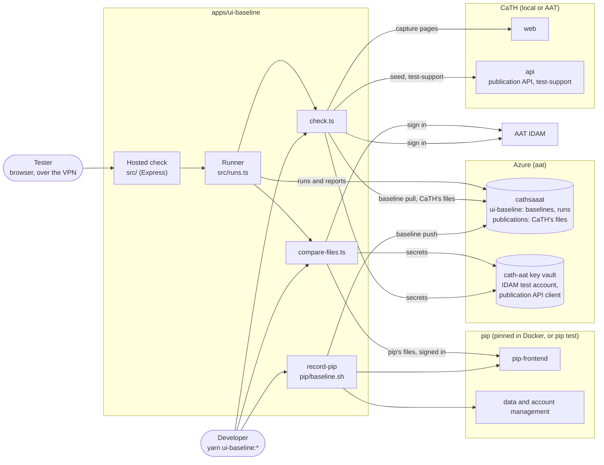
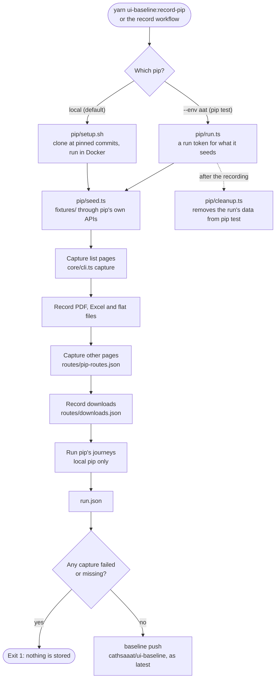
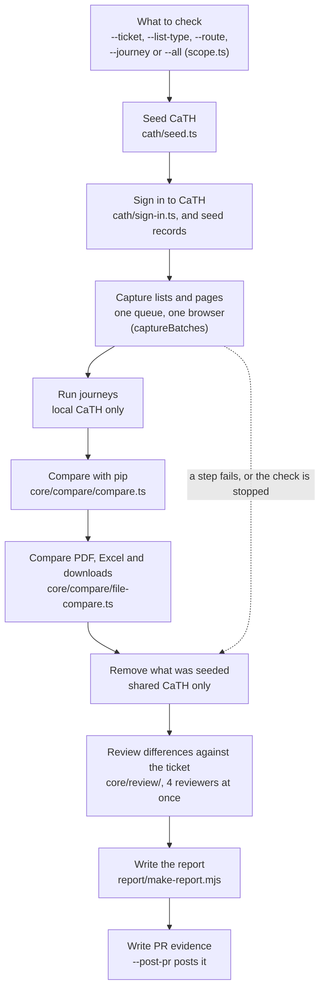
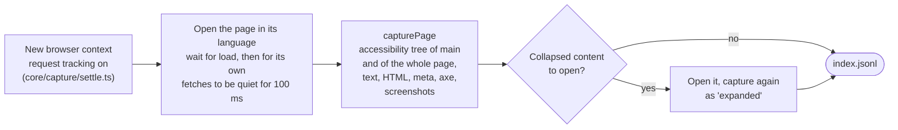
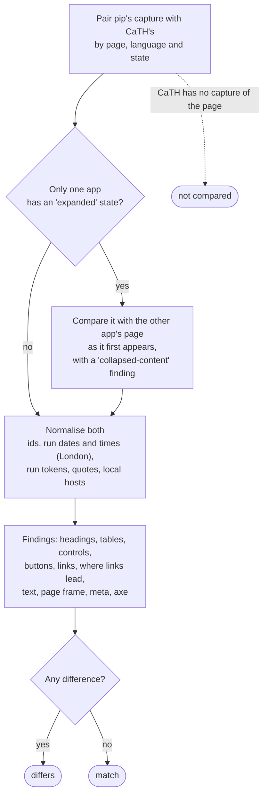
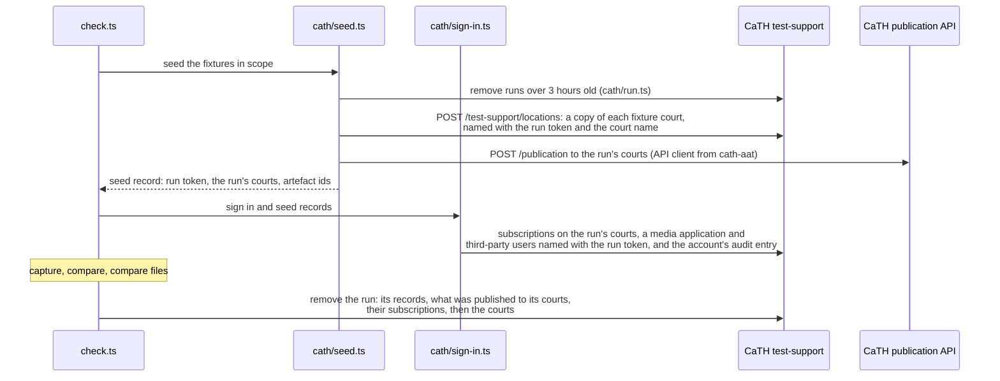
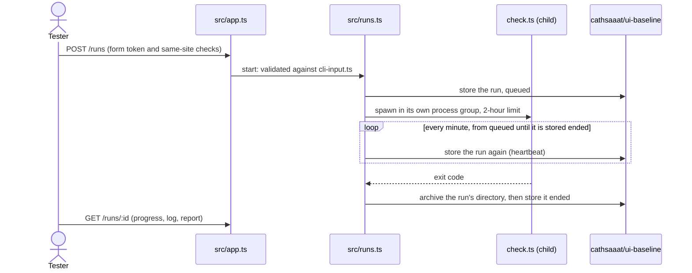
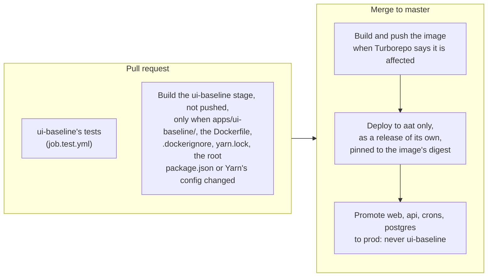

# How the UI baseline works

How the parts of `apps/ui-baseline` fit together: what records the pip baseline, what a check does
stage by stage, how a page is captured and compared, how a check leaves a shared CaTH as it found
it, and how the hosted check runs in aat. The [README](README.md) says how to use it; this page says
how it works. The diagrams are [Mermaid](https://mermaid.js.org/), which GitHub draws.

## The parts

- The **command line** (`yarn ui-baseline:check`, `compare-files`, `record-pip`) runs the scripts
  directly, against a local CaTH or CaTH AAT (`--env`, [`environments.json`](environments.json)).
- The **hosted check** (`src/`) is an Express app in aat. It runs the same scripts as child
  processes, one at a time, so a check started from the browser is the one a developer runs.
- **pip** is only ever read from or recorded, never changed outside a recording's own data.

## Recording the baseline

Both apps are seeded from the same committed fixtures (`fixtures/`), so pip's pages in the
baseline and CaTH's pages in a check show the same lists, users and records. A recording fails,
and is never stored, if any page, language or width it was asked for did not reach its index
(`pip/baseline.sh`), so an empty or partial baseline can never become the latest. With the
workflow's `store` input off, the whole recording is kept as a workflow artifact instead.

## A check, stage by stage

Every stage records its progress in `progress.json` ([`progress.ts`](progress.ts)), which is what
the hosted check's run page shows. Stages a check does not need (no journeys in scope, no ticket
to review against) are marked as skipped with the reason.

## Capturing one page

Each page is captured in English and Welsh, at desktop width (with collapsed content opened when
there is some) and at mobile width, and as each role pip shows it to. Captures run several at once
(`--concurrency`, 6 in the hosted check). A page is read once it has loaded and its own `fetch` and
XHR requests have been quiet for 100 ms, which waits for CaTH's court search to build its list
without Playwright's fixed 500 ms network-idle wait.

## Comparing a page

Values that differ between runs without meaning anything are normalised first
([`normalise.ts`](core/compare/normalise.ts)): ids, dates and times derived from when the data was
seeded (counted in London time, as both apps show them), a run's token on the courts and records it
seeded, curly and straight quotes. Each CaTH page is also checked for accessibility on its own
(`core/compare/accessibility.ts`), so a problem CaTH copied from pip is still reported.

## Seeding a shared CaTH (AAT) and leaving it as it was

Other people use CaTH AAT, so a check works as CaTH's own E2E tests do: it publishes through the
real publication API to courts of its own, and removes everything it seeded when it ends.

- **Nobody else is notified.** Nobody else subscribes to the run's courts, and the test account's
  own subscriptions are made after publishing. Third-party subscribers to a list type are still
  sent its lists, as with the E2E tests, as CaTH chooses them by list type, not court.
- **The run is removed however the check ends**: after the file comparison, when a later step
  fails (an `await using` disposal around the rest of `check.ts`), or when the check is stopped
  (`SIGTERM`, `SIGINT`). A stop that arrives while the removal is going waits for it to finish.
  If `seed.ts` itself fails partway, it removes its own courts.
- **Anything left behind is found again by its token.** A run that could not be removed (the pod
  was killed, say) is removed by a later check once it is three hours old. The courts go last, so
  a removal that fails partway leaves the courts for the next check to find the run by, and never
  stops that check. The audit entry is not named with the token: test-support cannot delete one, so
  every run reuses the test account's entry.
- **Locally**, CaTH is seeded at the fixture courts themselves (`location-data.ts`), and the
  publication is processed in this process, without notifications.

## The hosted check's runs

- **One run at a time.** Chromium is memory-hungry and checks seed the same environment, so runs
  queue. A run that goes past its two-hour limit is sent `SIGTERM` (a check removes what it
  seeded) and, two minutes later, `SIGKILL`, to its whole process group so its Chromium goes too.
- **Redeploys do not cut a run short.** A deploy with a new ui-baseline image starts a new pod,
  then stops the old one with `SIGTERM`. A master merge that did not rebuild the image leaves the
  pod running ([Building and deploying it](#building-and-deploying-it)). The old pod starts no new
  run and finishes the one it has going (`terminationGracePeriodSeconds: 9000`: the run's two-hour
  limit, its stop grace, and time to fetch the baseline and store the run). The new pod sees the
  recent heartbeat of each run queued or going there, leaves it and watches it until it ends; a run
  that has missed three heartbeats (three minutes) is marked interrupted. The heartbeat goes on
  while the run's files are archived, so a slow upload is not taken for a pod that has gone.
- **Queued runs are handed to the new pod, not failed.** On `SIGTERM` the old pod stores each run
  still queued there as handed over: still queued, with no pod (`owner`), and its heartbeat
  stopped. The new pod claims it and runs it, oldest first, ahead of runs asked of it since. Several
  pods can be up at once (one merge after another each starts a pod), so a claim is a write that
  only succeeds if the record is as the pod read it (its blob's ETag): one pod gets each run. A pod
  that is stopping claims nothing, and one that began stopping while a claim was being written
  hands the run over again. A handed-over run no pod claims within three heartbeats, as when
  the cluster is stopped for the night, is marked interrupted by the next pod to start, rather than
  run the next morning for a tester who has gone home. Its run page says it will still start, until
  it does (`handedOverAt`, then `takenOverAt` once claimed). With no storage (the app run locally),
  queued runs are failed with a message to start them again.
- **A pod lists the stored runs again every 30 seconds**, not only when it starts. The old pod still
  takes requests until it is stopped, so a run can be queued there after the new pod first looked;
  listing again finds it, to watch and then claim. Only runs asked for since yesterday are listed,
  by the date their ids start with. Marking a run interrupted is a conditional write too, whether
  the run is being watched or a pod has just started and found it stale: if a pod claimed the run
  or stored its heartbeat meanwhile, the record is read again rather than shown as interrupted.
- **A starting pod loads the runs of the last 30 days**, newest first, so the runs still queued or
  going are loaded before the history. Older runs stay in storage, but are not listed.
- **Each write of a run record gives up after 20 seconds.** Records are written one after another,
  so a write that hung would hold up every heartbeat after it, and other pods would take a run that
  is still going for interrupted.
- **A run started on the new pod waits for the old pod's run.** Two checks at once would share the
  IDAM test account and the records seeded in AAT, and change what each other captures. So the new
  pod queues a run until every run it is watching has ended, or been marked interrupted, and until
  it has loaded the runs stored before it started, so one started straight after a redeploy still
  waits. Its run page shows it queued meanwhile.
- **File comparisons** read CaTH's files from `cathsaaat` and pip's from pip-frontend
  (`/list-download-files`), signed in as the IDAM test account, as a verified user downloads them,
  so the pod needs no access to pip's storage ([`artefact-files.ts`](artefact-files.ts)).
- **Access** is the VPN: the host is in the private DNS zone with no Front Door route. There is no
  sign-in; each form carries a token matched to a `SameSite=Strict` cookie, and a cross-site post
  is refused ([`request-forgery.ts`](src/request-forgery.ts)).

## Building and deploying it

ui-baseline is a Helm release of its own (`<release>-ui-baseline`, chart `helm/`, values
`helm/values.aat.template.yaml`), deployed after cath-service's, not a subchart of it. helm-deploy
is `--atomic`, so as a subchart a ui-baseline pod that failed to start would have rolled back web
and api with it. On its own, only ui-baseline rolls back, and the deploy goes on with a warning.

The apps deployed to aat only are listed once, in
[`.github/workflows/jobs/aat-only-apps`](../../.github/workflows/jobs/aat-only-apps). That list
keeps ui-baseline out of pull request image builds (preview never deploys it), out of promotion to
prod, and out of the images demo, ithc and perftest look up. ui-baseline declares every workspace
library it uses, including each list type it seeds with, so a change to any of them rebuilds its
image on master (`package.test.ts` keeps the list complete).

The pod is replaced only when its image is rebuilt. Nothing in its pod spec changes from one deploy
to the next otherwise:

- **It is deployed by digest** (`cath-ui-baseline@sha256:…`), which `job.helm-deploy.yml` looks up
  from the tag it would have deployed. A master merge that rebuilds the image deploys
  `aat-<sha>`; one that does not deploys the floating `aat` tag. That is the same image, but a
  changed tag would still replace the pod. Its digest does not change. A rebuild always gives a new
  digest, though, even when nothing in the image changed: each build records its commit
  (`GIT_COMMIT`, below) and the time and revision in the image's labels. So the pod is left running
  only by merges that do not rebuild the image.
- **The commit a report records is built into the image** (`GIT_COMMIT`, a build argument of the
  Dockerfile's `ui-baseline` stage), not set by the chart, where the merge's own commit would
  change on every deploy. It is also the commit the image was built from, which the merge's commit
  is not when the image was not rebuilt.

Merges that only change libraries ui-baseline does not use, or CaTH's apps, leave it running. A
change to any library it does use still rebuilds and replaces it, as above.

## Where things are kept

| What | Where |
|---|---|
| Recorded baselines | `cathsaaat`, container `ui-baseline`, `baselines/`; locally `output/baseline` and Azurite |
| Hosted runs and their reports | `cathsaaat`, container `ui-baseline`, `runs/`; the pod's disk while it runs |
| CaTH's generated PDF and Excel files | CaTH's `publications` container |
| pip's generated files (hosted file comparisons) | Downloaded from pip-frontend as the test account |
| The IDAM test account, publication API client | `cath-aat` key vault |
| What a check seeded | CaTH itself, under the run's token; `output/seed/` holds the record for the check |
| Fixtures both apps are seeded with | `fixtures/` |
| Which pip page matches which CaTH page | `routes/route-map.json` |
