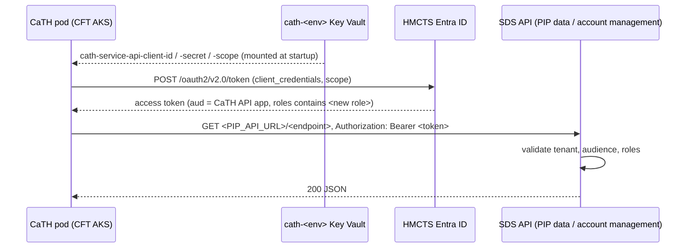

# #1482 Spike: SDS to CFT connectivity for reading PIP data via SDS API endpoints - Plan

> **Revised 2026-11-24.** The earlier plan compared direct network paths from CFT AKS to PIP's Postgres and Blob Storage (VNet peering, private endpoints, allow-lists, export). That approach has been dropped. SDS is building API endpoints that return the data CaTH needs, and CaTH calls them with a bearer token. There is no direct database or blob connection from CaTH to PIP.

## 1. Technical Approach

### Problem

The CaTH AI System Admin Dashboard needs read access to PIP data (Data Management and Account Management) during the PIP to CaTH migration, in every environment including PROD. CaTH runs on CFT AKS. PIP runs on SDS.

### Approach

1. SDS exposes HTTPS API endpoints that return the required data.
2. CaTH gets an Entra ID access token with the **client-credentials** grant, using the existing CaTH AI API app registration.
3. CaTH calls the SDS endpoints with `Authorization: Bearer <token>`.
4. SDS validates the token (tenant, audience and a new app role in the `roles` claim) and returns the data.



### What the repo already does (patterns to reuse)

| Concern | Existing pattern | Where |
|---|---|---|
| Client-credentials token over `fetch` | `fetchToken()` posts `grant_type=client_credentials` and checks `access_token` | `libs/third-party-subscription-fulfilment/src/oauth/access-token.ts`, `libs/third-party-user/src/access-token.ts` |
| CaTH API client secrets in the app vault | APIM reads `cath-service-api-client-id`, `-secret` and `-scope` from `cath-<env>` at runtime | `infrastructure/resources/api-policy/api-policy.xml` |
| Mounting vault secrets as env vars | `keyVaults.cath.secrets` with `alias` | `apps/api/helm/values.yaml` (`CATH_SERVICE_API_CLIENT_ID`, `CATH_SERVICE_API_CLIENT_SCOPE`, `AZURE_TENANT_ID` from `app-tenant-id`) |
| Env-var to config mapping | `config/custom-environment-variables.json` | `apps/crons/config/` |
| App role assigned by hand through Graph | `api.publisher.user` assigned to `cath-cp-<env>-mi` by an Entra admin | `docs/tickets/624/plan.md` (decision 4) |
| One-off or scheduled work in a pod | `apps/crons` picks a script by `SCRIPT_NAME` | `apps/crons/src/index.ts`, `apps/crons/helm/values.yaml` |
| Environment mapping to PIP | aat to PIP `staging`, perftest to PIP `test`, demo to `demo` | `apps/web/helm/values.yaml` (`B2C_CUSTOM_DOMAIN`) |

### Configuration

| Value | Source | Env var |
|---|---|---|
| SDS API base URL (per env) | Helm `environment` value, overridden per env in Flux. Not a secret | `PIP_API_URL` |
| Tenant ID | `cath-<env>` vault, `app-tenant-id` | `AZURE_TENANT_ID` |
| Client ID | `cath-<env>` vault, `cath-service-api-client-id` | `CATH_SERVICE_API_CLIENT_ID` |
| Client secret | `cath-<env>` vault, `cath-service-api-client-secret` | `CATH_SERVICE_API_CLIENT_SECRET` |
| Scope | `cath-<env>` vault, `cath-service-api-client-scope` | `CATH_SERVICE_API_CLIENT_SCOPE` |

`PIP_API_URL` is mapped through `apps/crons/config/custom-environment-variables.json` (key `pipApi.url`). The secrets are read straight from `process.env` after `getPropertiesVolumeSecrets()`, as the other crons secrets are. Nothing secret goes in config files or the repo.

### Authentication and the app role

- **Token request:** `POST https://login.microsoftonline.com/<AZURE_TENANT_ID>/oauth2/v2.0/token` with `grant_type=client_credentials`, `client_id`, `client_secret` and `scope` (from `cath-service-api-client-scope`, of the form `api://<client-id>/.default`).
- **New app role** on the CaTH AI API app registration, for example `api.pip.reader` (name TBC with SDS). `allowedMemberTypes: ["Application"]`. It is separate from `api.publisher.user`, so SDS can tell "may read PIP data" apart from "may publish to CaTH".
- **Assignment:** the role is assigned to the CaTH AI API service principal itself, so a client-credentials token for its own scope carries `roles: [..., "api.pip.reader"]`. As in #624, this is done by an Entra admin through Graph once per environment, not in Terraform, because the CI principal does not hold `AppRoleAssignment.ReadWrite.All`:

  ```bash
  az rest --method POST \
    --uri "https://graph.microsoft.com/v1.0/servicePrincipals/<CaTH API SP objectId>/appRoleAssignments" \
    --body '{"principalId":"<CaTH API SP objectId>","resourceId":"<CaTH API SP objectId>","appRoleId":"<api.pip.reader role id>"}'
  ```

- **SDS side:** SDS validates the issuer (HMCTS tenant), the audience (the CaTH API app ID) and `roles` containing the new role.
- **Open point:** this assumes SDS accepts tokens whose audience is CaTH's app. If SDS has its own API app registration instead, the role is defined on SDS's app and assigned to the CaTH service principal, and CaTH requests `api://<sds-app-id>/.default` instead of `cath-service-api-client-scope`. That needs a new `pip-api-scope` value. See clarification 2.
- **Token reuse:** cache the token in memory and refresh it 60 seconds before `expires_in`, as `access-token.ts` does. A crons Job is short-lived, so in-memory is enough. Redis is not needed.

### Network path

The SDS endpoints are HTTPS. How CFT AKS reaches them depends on how SDS publishes them (clarification 3):

- **Public endpoint (Front Door or APIM) with token auth.** No CaTH network changes. This is the simplest path.
- **Private / internal endpoint.** Needs a route or private endpoint and DNS from CFT AKS to SDS. Raise that with Platform Ops as a follow-up.

### Performance

- Reads go through SDS's API, not straight to PIP's database, so SDS controls the load on PIP.
- Ask SDS for rate limits and pagination (page size, cursor or offset). CaTH readers use paging and a small concurrency cap (2 to 4 parallel requests), and back off on `429` using `Retry-After`.
- Bulk migration reads run off-peak in a window agreed with SDS. Dashboard reads are on demand and cached, not polled.

### Data protection

Account Management data includes personal data (emails, names). Logs record status codes, counts and timings only, never response bodies or tokens. A DPIA update may be needed for PROD.

## 2. Implementation Details

TEMPLATE SOURCE: n/a

This is a spike. The deliverables are a write-up and a throwaway PoC. The production client and the infrastructure work are follow-up tickets.

### File structure

```
docs/tickets/1482/
├── ticket.md
├── plan.md
├── tasks.md
├── write-up.md                          # Recommendation, diagrams, approvals, PoC evidence
└── follow-up-tickets.md

apps/crons/
├── config/custom-environment-variables.json   # + pipApi.url -> PIP_API_URL
├── helm/values.yaml                            # PoC only: + client-id/-secret/-scope, app-tenant-id mounts
└── src/
    ├── pip-connectivity-check.ts               # Rewritten: token + one SDS GET (SCRIPT_NAME=pip-connectivity-check)
    └── pip-connectivity-check.test.ts
```

The PoC stays in `apps/crons` because that app already runs arbitrary scripts in a CFT AKS pod with mounted Key Vault secrets and App Insights. It stays on the spike branch and is **not merged to master**. The real client belongs in a lib (for example `libs/pip-api-client`), raised as a follow-up.

The old PoC (Postgres and Blob through `pg`, `@azure/storage-blob` and `@azure/identity`) is removed, along with those dependencies in `apps/crons/package.json`. No new dependencies are needed: Node's `fetch` covers both calls.

### PoC script outline

```typescript
// apps/crons/src/pip-connectivity-check.ts
import config from "config";

const REQUEST_TIMEOUT_MS = 10_000;

export default async function pipConnectivityCheck() {
  const accessToken = await getAccessToken();
  const response = await fetch(new URL(requireEnv("PIP_API_CHECK_PATH"), config.get<string>("pipApi.url")), {
    headers: { Authorization: `Bearer ${accessToken}`, Accept: "application/json" },
    signal: AbortSignal.timeout(REQUEST_TIMEOUT_MS)
  });
  if (!response.ok) throw new Error(`SDS API returned status ${response.status}`);
  const body: unknown = await response.json();
  console.log("SDS API read OK", { status: response.status, itemCount: Array.isArray(body) ? body.length : undefined });
}

async function getAccessToken(): Promise<string> {
  const response = await fetch(`https://login.microsoftonline.com/${requireEnv("AZURE_TENANT_ID")}/oauth2/v2.0/token`, {
    method: "POST",
    headers: { "Content-Type": "application/x-www-form-urlencoded" },
    body: new URLSearchParams({
      grant_type: "client_credentials",
      client_id: requireEnv("CATH_SERVICE_API_CLIENT_ID"),
      client_secret: requireEnv("CATH_SERVICE_API_CLIENT_SECRET"),
      scope: requireEnv("CATH_SERVICE_API_CLIENT_SCOPE")
    }),
    signal: AbortSignal.timeout(REQUEST_TIMEOUT_MS)
  });
  if (!response.ok) throw new Error(`Token endpoint returned status ${response.status}`);
  const { access_token } = (await response.json()) as { access_token?: unknown };
  if (typeof access_token !== "string" || access_token === "") throw new Error("Token response did not contain an access token");
  return access_token;
}

function requireEnv(name: string): string {
  const value = process.env[name];
  if (!value) throw new Error(`${name} is required`);
  return value;
}
```

Notes:

- `PIP_API_CHECK_PATH` is the one endpoint the PoC calls (TBC with SDS). It is a plain env var on the PoC Job only.
- Errors are put into categories for the write-up evidence: `CONFIG` (missing env var), `DNS`/`CONNECTION` (`ENOTFOUND`, `ETIMEDOUT`, `ECONNREFUSED`), `TOKEN` (Entra 4xx), `AUTH_DENIED` (SDS 401), `FORBIDDEN` (SDS 403, usually the role is missing), `UPSTREAM` (SDS 5xx), `UNKNOWN`. The crons runner turns a thrown error into exit code 1.
- Logs never include the token, the client secret or the response body.

### Running the PoC in AAT

1. **Token check, no SDS call.** From a machine with access to the `cath-aat` vault, request a token with the three secrets and decode it (for example with `jwt.ms`). Confirm `aud` is the CaTH API app and `roles` contains the new role. This separates Entra setup problems from SDS problems.
2. **Network probe.** From a throwaway pod in the `cath` namespace on cft-aat, run `nslookup` and `curl -sS -o /dev/null -w '%{http_code}'` against `PIP_API_URL`. Expect a `401` without a token. That proves reachability.
3. **Job run.** Build the crons image from the spike PR and apply a one-off Job (`SCRIPT_NAME=pip-connectivity-check`, `PIP_API_URL`, `PIP_API_CHECK_PATH`) with the secrets mounted. If devs can't create Jobs in `cath` on cft-aat, use a temporary HelmRelease in `cnp-flux-config`.

### Helm (PoC, then follow-up)

```yaml
# apps/crons/helm/values.yaml
job:
  environment:
    PIP_API_URL: ""            # set per env in Flux
  keyVaults:
    cath:
      secrets:
        - name: app-tenant-id
          alias: AZURE_TENANT_ID
        - name: cath-service-api-client-id
          alias: CATH_SERVICE_API_CLIENT_ID
        - name: cath-service-api-client-secret
          alias: CATH_SERVICE_API_CLIENT_SECRET
        - name: cath-service-api-client-scope
          alias: CATH_SERVICE_API_CLIENT_SCOPE
```

Only the workload that calls SDS (crons or the dashboard) gets these, not every chart.

## 3. Error Handling & Edge Cases

| Case | Symptom | Handling and diagnosis |
|---|---|---|
| Missing env var or secret | `CONFIG: <NAME> is required` | Secret not mounted (check `keyVaults` aliases) or `PIP_API_URL` not set in Flux |
| Entra rejects the client | Token endpoint `400`/`401` (`invalid_client`, `AADSTS7000215`) | Wrong or expired client secret. Check the secret's expiry in the app registration |
| Invalid scope | `AADSTS70011` / `AADSTS500011` | Scope value wrong, or SDS expects its own audience (clarification 2) |
| Token has no role | SDS `403` | App role not assigned to the CaTH SP in that env. Decode the token and check `roles` |
| SDS rejects the audience | SDS `401` | SDS is validating a different audience. Agree the audience with SDS |
| DNS failure | `ENOTFOUND` | Wrong `PIP_API_URL`, or a private-only endpoint not resolvable from CFT |
| Network blocked | `ETIMEDOUT` / `ECONNREFUSED` | SDS endpoint is private or IP-restricted. Raise the network follow-up |
| TLS failure | certificate errors | Use the FQDN SDS publishes. Never turn off TLS verification |
| Rate limited | `429` | Honour `Retry-After`, lower concurrency |
| SDS error | `5xx` | Retry with backoff in the real client. The PoC fails and records it |
| Token expiry on long runs | `401` after about 60 minutes | Real client refreshes 60 seconds before expiry |
| Secret expiry | Token requests start failing | Record the client secret's expiry date and who rotates it |
| Personal data in logs | n/a | Status, counts and timings only. Reviewed in the PR |

## 4. Acceptance Criteria Mapping

| AC | How it is satisfied | How it is verified |
|---|---|---|
| The approach is agreed with Platform Ops and the security teams | `write-up.md` circulated, then a review with Platform Ops, security and SDS | Approvals (names, dates, links) recorded in `write-up.md` |
| The proof of concept works in non-prod: CaTH gets a token and gets data back from an SDS endpoint | `pip-connectivity-check` Job in AAT gets a token and a `200` from one SDS endpoint | Job logs and exit code 0 in `write-up.md`, plus the negative checks |
| The new app role exists on the CaTH AI API app registration and is assigned in each environment | Role added to the app registration, assigned by an Entra admin per env | Decoded token shows the role in each env. Assignment recorded in `write-up.md` |
| The PROD path, the credentials it needs and the approvals it needs are documented | PROD section in `write-up.md`: secrets in `cath-prod`, role assignment, network path, DPIA | Reviewed in the same session. Each item has a follow-up ticket |
| No direct database or blob connection from CaTH to PIP | All access is HTTPS to `PIP_API_URL`. The `pg` and blob code and dependencies are removed | Code review of the PoC. No Postgres or storage hostnames in config |

## 5. Test Scenarios

PoC verification, run in AAT against SDS staging.

| # | Scenario | Expected | Task |
|---|---|---|---|
| 1 | Request a token with the `cath-aat` secrets and decode it | `aud` is the CaTH API app, `roles` contains the new role | T5 |
| 2 | `curl` `PIP_API_URL` without a token from a `cath` pod on cft-aat | Resolves, connects, returns `401` | T6 |
| 3 | Job calls one SDS endpoint with a token | `200`, exit 0, status and count logged | T8 |
| 4 | Call with no `Authorization` header | `401` | T9 |
| 5 | Call with a token that lacks the role (role temporarily unassigned, or a different client) | `403` | T9 |
| 6 | Job with `CATH_SERVICE_API_CLIENT_SECRET` wrong | Fails fast with a `TOKEN` error, no hang | T9 |
| 7 | Job with `PIP_API_URL` unset | Fails fast with a `CONFIG` error | T9 |
| 8 | Unit tests for `pip-connectivity-check.ts` (mocked `fetch`): success, missing env var, token endpoint error, missing `access_token`, SDS 401/403/5xx, network error, secrets never logged | All pass | T7 |
| 9 | Load: SDS and PIP metrics during the run | No measurable impact | T10 |

## 6. CLARIFICATIONS NEEDED

SDS team:

1. Which endpoints exist or are planned for Data Management and Account Management? Base URLs per env, paths, request and response contracts (OpenAPI if available). Which one should the PoC call?
2. Which **audience** will SDS validate: the CaTH API app ID (tokens from `cath-service-api-client-scope`), or SDS's own app registration? Which **role name** will SDS check?
3. Are the endpoints public (Front Door or APIM) or private? If they are private or IP-restricted, what network path from CFT AKS do they expect?
4. Rate limits, pagination, and an off-peak window for bulk reads?
5. Env-name mapping: aat to `staging`, perftest to `test`, demo to `demo`, prod to `prod`?

CaTH / Entra:

6. Who is the Entra admin who creates the app role and its assignment in each env, including PROD?
7. When does `cath-service-api-client-secret` expire in each env, and who rotates it?
8. Is reusing the CaTH AI API app registration acceptable to security, given it already carries `api.publisher.user` and APIM uses it to call `cath-api`? Or is a separate app registration wanted for PROD?

Platform Ops:

9. Can devs create a one-off Job in the `cath` namespace on cft-aat, or must it go through `cnp-flux-config`?
10. Only if clarification 3 says private: is there a route from CFT AKS to the SDS endpoints?

Security and IG:

11. Is a DPIA update needed for CaTH reading PIP account-management personal data through the API?

PROD dependencies:

12. Do the `cath-service-api-client-*` secrets and `app-tenant-id` exist in the `cath-prod` vault, and is the PROD subscription ready (#1095)?

---

# Part 2: System admin "Migration" area with a PIP connection check

> **Added 2026-11-25.** In scope for #1482 (decided by the ticket owner, no separate ticket). This replaces the crons Job as the way to test the connection. It runs from the web pod (the workload the dashboard actually runs in) and needs no kubectl rights. Unlike the PoC, this code is **merged to master**.

## 7. Technical Approach

### User journey

```
System Admin Dashboard ──(tile "Migration")──> /migration
   /migration ──(tile "Check PIP connection")──> /migration-connection-check
   /migration-connection-check: enter a URL ──"Test connection"──> POST, same page shows the result
```

### Behaviour

1. A system admin enters a full URL, for example `https://pip-data-management.staging.platform.hmcts.net/locations/111`, and selects **Test connection**.
2. The server validates the URL against an **allow-list of hosts** for the environment (`PIP_API_ALLOWED_HOSTS`). The field stays free text, so Account Management and other PIP APIs can be checked later just by adding their host to the list.
3. Only after the URL passes validation, the server gets a client-credentials token (CaTH AI API app registration) and sends `GET <url>` with `Authorization: Bearer <token>`. Redirects are not followed. The response body is discarded unread.
4. The page shows: URL tested, Result, HTTP status, Response time, Access token obtained (Yes/No).

### Why an allow-list rather than any URL

The request is made from inside CFT with the CaTH client's bearer token. Without a host allow-list, anyone with system admin could:
- make the server call internal-only addresses (for example `169.254.169.254` Azure metadata, cluster services), which is server-side request forgery;
- send the CaTH token to a host they control and reuse it, including the `api.publisher.user` role it already carries.

The allow-list keeps the field free text while making both impossible. The list comes from config, not the form.

### URL rules (in this order)

| Rule | Error (en) |
|---|---|
| Not empty | Enter a URL |
| At most 2,048 characters | URL must be 2,048 characters or fewer |
| Parses as a URL, scheme `https`, no username or password | Enter a URL in the correct format, like https://pip-data-management.staging.platform.hmcts.net/locations/1 |
| Host (case-insensitive, port must be empty or 443) exactly matches an entry in `PIP_API_ALLOWED_HOSTS` | Enter a URL for an allowed PIP API: `<host list>` |

If `PIP_API_ALLOWED_HOSTS` is empty or the client secrets are missing, the page shows an inset text "The PIP connection check is not set up in this environment", and a POST returns that message without calling anything.

### Result mapping

| Outcome | Result shown (en) |
|---|---|
| Token request failed (HTTP status, invalid response, network error, timeout) | Could not get an access token, with the reason |
| `2xx` | Connected |
| `3xx` | Redirected (not followed) |
| `401` | Not authorised: the PIP API rejected the access token |
| `403` | Forbidden: the token was accepted but does not have the required role |
| `404` | Not found: check the URL |
| `429` | Rate limited |
| `5xx` | The PIP API returned an error |
| Other status | The PIP API returned status N |
| Network error (`ENOTFOUND`, `ECONNREFUSED`, ...) | Could not reach the PIP API, with the safe error code |
| Timeout | The request timed out |

Unauthenticated endpoints such as `/locations/{id}` return `200` without a token, so "Connected" there proves the network path only. The page says this in hint text: "A Connected result only proves authentication if the endpoint requires a token."

### Configuration (web)

| Value | Source | Env var |
|---|---|---|
| Allowed hosts | `apps/web/helm/values.yaml` `environment`, templated per env with the same `aat`→`staging` / `perftest`→`test` map as `B2C_CUSTOM_DOMAIN` | `PIP_API_ALLOWED_HOSTS` (comma-separated) |
| Tenant | `cath` vault `app-tenant-id` | `AZURE_TENANT_ID` |
| Client ID / secret / scope | `cath` vault `cath-service-api-client-id` / `-secret` / `-scope` | `CATH_SERVICE_API_CLIENT_ID` / `_SECRET` / `_SCOPE` |

```yaml
PIP_API_ALLOWED_HOSTS: 'pip-data-management.{{ get (dict `aat` `staging` `perftest` `test`) .Values.global.environment | default .Values.global.environment }}.platform.hmcts.net,pip-account-management.{{ get (dict `aat` `staging` `perftest` `test`) .Values.global.environment | default .Values.global.environment }}.platform.hmcts.net'
```

`TBC:` prod hostnames (PIP prod may not follow `<app>.<env>.platform.hmcts.net`) and the preview value (`preview` has no PIP env; set it to the staging hosts in `values.preview.template.yaml`).

### Security trade-off: client secret in the web pod

The web pod does not mount `cath-service-api-client-secret` today. Mounting it means a compromise of the public-facing web app also exposes a credential that holds `api.publisher.user` (publish to CaTH). This is accepted for non-prod to unblock testing. Before PROD, security decides between accepting it and a separate app registration with only the PIP read role (clarification 8). The page is system-admin only and the secret never leaves the server.

### Audit

Unlike the #829 subscriber test (not audited), this takes a free-text URL and sends a credential, so each test **is** audit-logged: action `PIP_CONNECTION_CHECK`, with the host, the path, the result category and the status. No query string (it could carry identifiers), no body, no token.

### Code reuse

`libs/third-party-user` already has the pieces, unexported: `sendOutboundRequest()` (timeout, `redirect: "manual"`, safe error codes), `discardBody()` and `requestAccessToken()`. Export them (and their result types) from `@hmcts/third-party-user` and use them from the new lib, rather than copying them. If reviewers prefer, move them to a small `libs/oauth-client` later. That is a pure move.

### What happens to the crons PoC

This PR now merges to master, and the crons version would mount the client secret into every crons job. Remove `apps/crons/src/pip-connectivity-check*.ts`, the `pipApi.url` config mapping and the four crons secret mounts. The web page replaces them. The crons evidence already gathered stays in `write-up.md`.

## 8. Implementation Details

### File structure

```
libs/pip-api-client/                         # @hmcts/pip-api-client (follow-up T16 starts here)
├── package.json  tsconfig.json
└── src/
    ├── index.ts                             # exports checkPipConnection, validatePipUrl, getAllowedPipHosts, types
    ├── allowed-hosts.ts (+ .test.ts)        # parse PIP_API_ALLOWED_HOSTS
    ├── url-validation.ts (+ .test.ts)       # rules table above -> { kind: "valid", url } | { kind: "invalid", error }
    └── connection-check.ts (+ .test.ts)     # token + GET, timing, result union

libs/third-party-user/src/index.ts           # + export requestAccessToken, sendOutboundRequest, discardBody, types

apps/web/src/pages/(system-admin)/
├── system-admin-dashboard/en.ts, cy.ts      # + "Migration" tile -> /migration
├── migration/                               # hub page: one tile for now
│   ├── index.ts  index.njk  en.ts  cy.ts  index.test.ts  index.njk.test.ts
└── migration-connection-check/
    ├── index.ts  index.njk  en.ts  cy.ts  index.test.ts  index.njk.test.ts

apps/web/helm/values.yaml                    # + PIP_API_ALLOWED_HOSTS, + 4 secret mounts
helm/cath-service/values.preview.template.yaml  # PIP_API_ALLOWED_HOSTS = staging hosts
root tsconfig.json                           # + @hmcts/pip-api-client path
apps/web/package.json                        # + "@hmcts/pip-api-client": "workspace:*"
e2e-tests/tests/system-admin/system-admin-dashboard.spec.ts   # + Migration tile in tileData (no new E2E spec)
```

### Lib API

```typescript
// libs/pip-api-client/src/url-validation.ts
export function validatePipUrl(input: string, allowedHosts: readonly string[]): UrlValidationResult;

export type UrlValidationResult =
  | { kind: "valid"; url: URL }
  | { kind: "invalid"; error: "required" | "too-long" | "invalid-format" | "host-not-allowed" };

// libs/pip-api-client/src/connection-check.ts
export async function checkPipConnection(url: URL): Promise<PipConnectionResult>;

export type PipConnectionResult =
  | { kind: "not-configured" }
  | { kind: "token-failure"; reason: TokenFailureReason }
  | { kind: "response"; status: number; durationMs: number }
  | { kind: "network-error"; code?: string; durationMs: number }
  | { kind: "timeout"; durationMs: number };
```

`checkPipConnection` reads the four env vars, builds `https://login.microsoftonline.com/<tenant>/oauth2/v2.0/token`, calls `requestAccessToken`, then `sendOutboundRequest(url, { method: "GET", headers: { Authorization, Accept: "application/json" } })`, then `discardBody`. It times only the GET. No token caching: a manual button press does not need it (YAGNI).

### Controller (`migration-connection-check/index.ts`)

```typescript
export const GET: RequestHandler[] = [requireRole([USER_ROLES.SYSTEM_ADMIN]), getHandler];
export const POST: RequestHandler[] = [requireRole([USER_ROLES.SYSTEM_ADMIN]), postHandler];
```

- `getHandler`: renders the form, the allowed hosts as hint text, and the not-configured inset text when needed.
- `postHandler`: `validatePipUrl(req.body.url, getAllowedPipHosts())`. If invalid, re-render with `govukErrorSummary` and the inline error, keeping the entered value. If valid, `checkPipConnection(url)`, set `req.auditMetadata` (action `PIP_CONNECTION_CHECK`, host/path/result/status), map to a result view model with the locale, and re-render with the value kept so the admin can retry.

### Templates

- `migration/index.njk`: reuses the `admin-tile` markup from the dashboard, with one tile "Check PIP connection".
- `migration-connection-check/index.njk`:
  - back link to `/migration`, `h1` "Check connection to PIP";
  - `govukInput` (`id`/`name` `url`, `type: "url"`, `spellcheck: false`, `autocomplete: "off"`), label "URL to test", hint listing the allowed hosts and the unauthenticated-endpoint caveat;
  - `govukButton` "Test connection";
  - result: the existing `.connection-result` block (`role="alert"`, success/fail modifier from #829) containing a `govukSummaryList` with URL tested, Result, HTTP status, Response time, Access token obtained.
- Welsh: every string in `cy.ts`, with `[WELSH TRANSLATION REQUIRED: '...']` placeholders where no translation is available yet, as the repo does elsewhere.

## 9. Error Handling & Edge Cases

| Case | Handling |
|---|---|
| Not a system admin | `requireRole` returns the standard 403 or sign-in redirect |
| `PIP_API_ALLOWED_HOSTS` unset or empty | Not-configured inset text. POST calls nothing |
| Client secrets missing | `checkPipConnection` returns `not-configured`. Nothing is sent |
| `http://`, a username/password in the URL, `javascript:`, invalid URL | `invalid-format` |
| Host on the list but with a different port, for example `:8443` | `host-not-allowed` |
| Look-alike hosts (`pip-data-management.staging.platform.hmcts.net.evil.com`, `evil.com#@pip-...`) | `URL.hostname` exact match, so `host-not-allowed` |
| Upper-case host, trailing dot | Lower-cased. A trailing dot is stripped before comparing |
| Allowed host redirects elsewhere | `redirect: "manual"` shows "Redirected (not followed)". The token never goes to the redirect target |
| Very slow endpoint | `sendOutboundRequest` 30 s timeout, shown as "The request timed out" |
| Large or personal-data response | Body discarded unread. Never rendered or logged |
| Token or secret in logs or the audit record | Never logged. Only the host, path, status and category |
| Double submit | Harmless: a read-only GET |

## 10. Acceptance Criteria Mapping (Part 2)

| Requirement | Verified by |
|---|---|
| Dashboard has a "Migration" tile leading to a Migration page with a "Check PIP connection" tile | Dashboard and migration page unit and template tests. E2E journey |
| Free-text URL plus **Test connection** shows the HTTP status and a plain-English result | Controller and lib unit tests. Manual run in aat against `/locations/111` |
| Only allow-listed PIP hosts are called | `url-validation.test.ts` (look-alike, port, scheme, credentials cases). E2E enters a disallowed host |
| Works for Account Management later without code changes | Allow-list is config. Unit test with two hosts |
| No token, secret or response body is shown or logged | Lib tests assert the logs and audit metadata |
| Welsh and accessibility | Template tests with `cy`. Locale-key parity. Axe in E2E |

## 11. Test Scenarios (Part 2)

Unit (Vitest):
- `allowed-hosts`: comma-separated parsing, whitespace, empty entries, case.
- `url-validation`: each rule and each edge case in section 9.
- `connection-check`: not configured; token failures (status, invalid body, network, timeout); `GET` with the bearer header and `redirect: "manual"`; each status category; network error code; timeout; body discarded; nothing secret logged.
- Controllers: GET renders the form and hosts; GET not-configured; POST invalid keeps the value and shows the errors; POST valid calls the check and sets audit metadata; Welsh content.
- Templates (`*.njk.test.ts`): error summary present and absent; result block success and fail modifiers; summary list rows; not-configured inset; Welsh; locale-key parity for both pages.

E2E: **no new spec**. The ticket owner decided against an E2E test for this page. The only E2E change is adding the Migration tile to `system-admin-dashboard.spec.ts`, which asserts the exact tile list. The real connection is checked by hand in aat (T28) and recorded in `write-up.md`.

### As built (2026-11-25)

- `requestAccessToken` now takes `TokenRequestConfig` (`tokenUrl`, `clientId`, `clientSecret`, `scope`), a `Pick` of `OauthConfig`, so callers don't need a `destinationUrl`. No behaviour change for #829.
- The page's locale key for validation messages is `errorMessages`, not `errors`. Spreading the locale into the template with an `errors` key made `` true and rendered an empty error summary.
- `PIP_API_ALLOWED_HOSTS` in `apps/web/helm/values.yaml` renders empty for `prod`. Preview sets the staging hosts explicitly.
- Audit: a successful check logs `PIP_CONNECTION_CHECK` with `Host; Path; Result; Status`. A validation failure logs `PIP_CONNECTION_CHECK` with the validation message. A POST when not configured is not logged.

## 12. CLARIFICATIONS NEEDED (Part 2)

13. PROD hostnames for PIP Data Management and Account Management (for `PIP_API_ALLOWED_HOSTS`)? **Decided:** prod empty until confirmed.
14. Security: accept the client secret in the web pod for non-prod now? **Decided:** yes. PROD decided under clarification 8.
15. Should the check be audit-logged? Default: yes (section 7).
16. OK to remove the crons PoC from this PR now that the web page replaces it? **Decided:** yes, removed.
