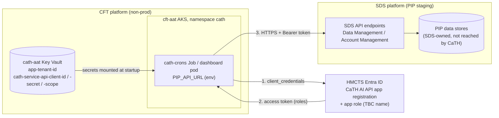

# #1482 Spike write-up: CaTH AI reading PIP data through SDS API endpoints

> **Status: DRAFT, revised 2026-11-24.** The earlier draft recommended direct network paths to PIP's Postgres and Blob Storage. That approach has been dropped in favour of SDS API endpoints. Items marked `TBC:` depend on answers from SDS, the Entra admin, Platform Ops or security (tasks T1 to T4), or on PoC evidence (T5 to T10). Approvals (T13) have not been sought.

## 1. Summary

The CaTH AI System Admin Dashboard needs read access to PIP Data Management and Account Management data in every environment, including PROD. CaTH runs on CFT AKS and PIP on SDS.

**Recommendation:** CaTH does not connect to PIP's databases or storage. SDS exposes HTTPS API endpoints that return the data. CaTH calls them with a bearer token from the existing CaTH AI API app registration (client-credentials grant), and the token carries a new app role that SDS checks.

| Concern | Decision |
|---|---|
| Data access | SDS API endpoints only. No Postgres or Blob connection |
| API URL | `PIP_API_URL` env var per environment, set in Helm/Flux |
| Credentials | Existing `cath-service-api-client-id`, `-secret` and `-scope` in the `cath-<env>` vault, plus `app-tenant-id`. Mounted through Helm `keyVaults` |
| Authorisation | New app role on the CaTH AI API app registration (`TBC: name`), assigned per env by an Entra admin |
| Network | `TBC: public (Front Door/APIM) or private SDS endpoint (clarification 3)` |

## 2. Diagrams

### AAT/Staging (CaTH `aat` to SDS `staging`), then demo and perftest

`TBC: env-name mapping (clarification 5).`

### PROD (CaTH `prod` to SDS `prod`)

Same shape. Differences:

- Secrets come from the `cath-prod` vault. `TBC: confirm they exist (clarification 12).`
- The app role is assigned in the PROD tenant setup by the Entra admin (`TBC: who, clarification 6`).
- Only the workload that needs PIP data mounts the secrets and `PIP_API_URL`.
- Bulk reads run off-peak in a window agreed with SDS.
- Depends on the PROD subscription work (#1095).

## 3. Auth model

- **Grant:** `client_credentials` against `https://login.microsoftonline.com/<tenant>/oauth2/v2.0/token`.
- **Client:** the existing CaTH AI API app registration. No new app registration and no new secrets.
- **Scope:** `cath-service-api-client-scope` (`api://<client-id>/.default`). The token's audience is the CaTH API app.
  - `TBC: SDS to confirm they accept this audience. If SDS has its own app registration, the role goes on their app and CaTH requests their scope instead (clarification 2).`
- **App role:** a new role (for example `api.pip.reader`, `allowedMemberTypes: Application`), separate from `api.publisher.user`. It is assigned to the CaTH API service principal through Graph by an Entra admin, the same as the #624 assignment, because the CI principal cannot do it from Terraform.
- **SDS validation:** issuer (HMCTS tenant), audience, and `roles` containing the new role.
- **Token reuse:** in-memory cache, refreshed 60 seconds before expiry.
- **Secret lifecycle:** `TBC: client secret expiry and rotation owner (clarification 7).`
- **Reuse risk:** the same app registration already holds `api.publisher.user`, and APIM uses it to call `cath-api`. A leak of this one secret would give both publish rights to CaTH and read rights to PIP data. `TBC: security to accept, or ask for a separate app registration for PROD (clarification 8).`

## 4. Performance

- SDS controls the load on PIP's data stores, because CaTH only reaches them through the API.
- `TBC: rate limits and pagination (clarification 4).` CaTH readers page through results, cap concurrency at 2 to 4 requests, and back off on `429`/`5xx`.
- Bulk migration runs are scheduled off-peak. Dashboard reads are on demand and cached.
- `TBC: observed impact during the PoC (T10).`

## 5. Proof of concept

**Code:** `apps/crons/src/pip-connectivity-check.ts` (`SCRIPT_NAME=pip-connectivity-check`), spike branch only, not merged to master. It:

- reads `AZURE_TENANT_ID`, `CATH_SERVICE_API_CLIENT_ID`, `CATH_SERVICE_API_CLIENT_SECRET` and `CATH_SERVICE_API_CLIENT_SCOPE` (mounted from `cath-aat`), plus `PIP_API_URL` and `PIP_API_CHECK_PATH`;
- gets a client-credentials token, then makes one `GET` to the SDS endpoint with a 10-second timeout;
- logs only the HTTP status and an item count;
- fails with a categorised error (`CONFIG`, `DNS`, `CONNECTION`, `TOKEN`, `AUTH_DENIED`, `FORBIDDEN`, `UPSTREAM`, `UNKNOWN`), which the crons runner turns into exit code 1.

Rewritten (T7). `pg`, `@azure/storage-blob` and `@azure/identity` are no longer added to `apps/crons`. `PIP_API_URL` maps to `pipApi.url` in `apps/crons/config/custom-environment-variables.json`, and `apps/crons/helm/values.yaml` mounts `app-tenant-id` and the three `cath-service-api-client-*` secrets. `PIP_API_URL` and `PIP_API_CHECK_PATH` are set on the PoC Job, not in the chart defaults.

**Evidence** (none gathered yet):

| # | Scenario | Result | Evidence link |
|---|---|---|---|
| 1 | Token decoded: `aud` and `roles` correct | `TBC: T5` | `TBC` |
| 2 | `PIP_API_URL` reachable from a `cath` pod (`401` without a token) | `TBC: T6` | `TBC` |
| 3 | Job gets `200` from one SDS endpoint | `TBC: T8` | `TBC` |
| 4 | No token returns `401` | `TBC: T9` | `TBC` |
| 5 | Token without the role returns `403` | `TBC: T9` | `TBC` |
| 6 | Wrong secret fails fast | `TBC: T9` | `TBC` |
| 7 | Missing URL fails fast | `TBC: T9` | `TBC` |
| 8 | Unit tests | Passing locally (41 tests in `@hmcts/crons`, 100% lines on `pip-connectivity-check.ts`) | Spike PR `TBC` |
| 9 | Load on SDS during the run | `TBC: T10` | `TBC` |

## 6. PROD path and approvals

| Approval or prerequisite | Owner | Follow-up | Status |
|---|---|---|---|
| Overall approach | Platform Ops, security, SDS | n/a (T13) | `TBC` |
| Audience and role contract | SDS | T15 | `TBC` |
| App role created and assigned per env, including PROD | Entra admin | T15 | `TBC` |
| Reuse of the CaTH AI API app registration in PROD | Security | T15 | `TBC` |
| Secrets present in `cath-prod` | CaTH / Platform Ops | T16 | `TBC` |
| `PIP_API_URL` per env | CaTH (Flux) | T17 | `TBC` |
| Network path (only if private) | Platform Ops | T18 | `TBC` |
| DPIA update and PROD access | Security and IG | T19 | `TBC` |
| PROD subscription readiness | Platform Ops | #1095 | `TBC` |

## 7. Open questions and answers

| # | Question | Owner | Answer |
|---|---|---|---|
| 1 | Endpoints, base URLs per env, contracts. Which endpoint for the PoC? | SDS | `TBC` |
| 2 | Audience SDS validates, and the role name | SDS | `TBC` |
| 3 | Public or private endpoints? | SDS | `TBC` |
| 4 | Rate limits, pagination, off-peak window | SDS | `TBC` |
| 5 | Env-name mapping | SDS | `TBC` |
| 6 | Entra admin for role creation and assignment | CaTH / Entra | `TBC` |
| 7 | Client secret expiry and rotation | CaTH / Entra | `TBC` |
| 8 | Reusing the CaTH AI API app registration acceptable? | Security | `TBC` |
| 9 | Job-creation rights in `cath` on cft-aat | Platform Ops | `TBC` |
| 10 | Network route, only if private | Platform Ops | `TBC` |
| 11 | DPIA update | Security / IG | `TBC` |
| 12 | Secrets in `cath-prod`, #1095 readiness | CaTH / Platform Ops | `TBC` |

## 8. Approvals record

`TBC: T13 review not yet held.`

| Team | Name | Date | Decision | Link |
|---|---|---|---|---|
| Platform Ops | `TBC` | `TBC` | `TBC` | `TBC` |
| Security architecture | `TBC` | `TBC` | `TBC` | `TBC` |
| SDS team | `TBC` | `TBC` | `TBC` | `TBC` |

## 9. Follow-up tickets

Drafts are in `docs/tickets/1482/follow-up-tickets.md` (T15 to T19). Issue numbers: `TBC: not yet raised`.
